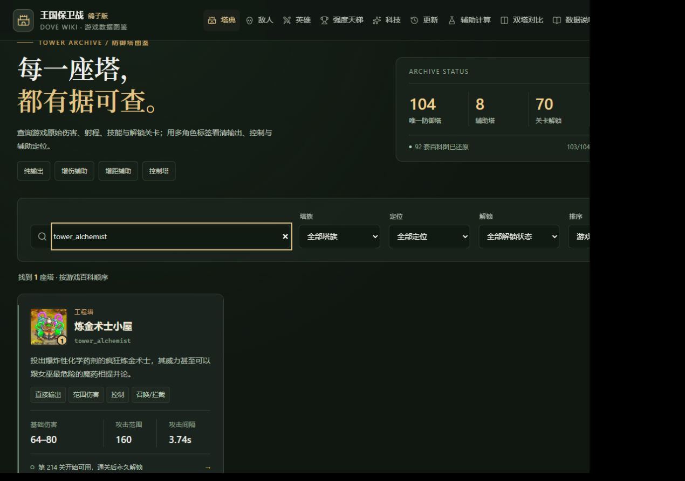
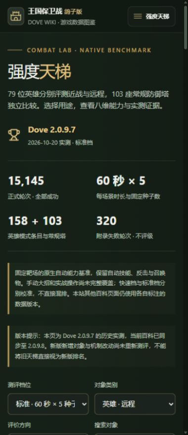

# UI、强度天梯与 Dove 2.0.9.8 数据集成

解决 `codex/refactoring-ui` 合入 `dev` 时 App.vue 的导入冲突，同时保留
`provide` 工作区、敌人面板带入、跨页面参数与滚动状态，以及异步强度天梯页面。

## 游戏快照

读取本机原生模板、中文文本、百科及图集，游戏版本 **2.0.9.8**，提交
`8c10091108e554d8643e787989ac69afc7fc7a18`。

- 104 座塔、79 位英雄、354 个敌人槽位（350 个唯一敌人）。
- 92 套塔百科图、227 张塔技能图、144 张科技图标。
- 新增炼金术士小屋的原生数据与六张资源图。
- 1425 个资源引用有效，解锁异常为零。

机制审阅独立于数据提取。当前 164 条塔机制说明、68 条英雄机制说明待复核；
11 项辅助及条件/概率科技规则因依赖源码变化停止计算，仍有效的六项辅助继续可用。
本次未刷新人工审阅指纹，也未将待复核说明冒充为新版已核实结论。

强度天梯仍是 **2.0.9.7 历史实测**，包含 103 座常规塔和 79 位英雄的近远程模式。
页面明确提示与当前百科的版本差异；炼金术士等新增对象不补造排名。

## 回归检查

旧公式测试现在使用带来源提交和原始快照 SHA-256 的固定已审阅样本，
不再假定每次同步后的所有机制都已人工审阅。当前快照另行检查失效辅助与科技
不进入计算。快照校验的负例独立构造无效结论，适用于所有塔说明均待复核的版本。

146 项单元/数据测试通过，Pages 基路径生产构建通过。浏览器回归覆盖 320、390、
768、1280px，按真实快照区分有效辅助与待复核辅助，并新增天梯筛选和直接地址刷新流程。
依赖待复核辅助的半径/次数输入流程，仅在对应机制重新审阅有效时执行；当前检查停用状态。

桌面 1280px 与手机 390px 人工检查无横向溢出，原生资源正常显示，跨天梯导航保留计算参数。

